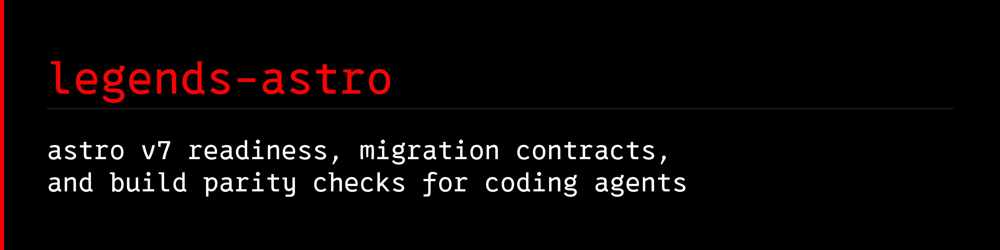
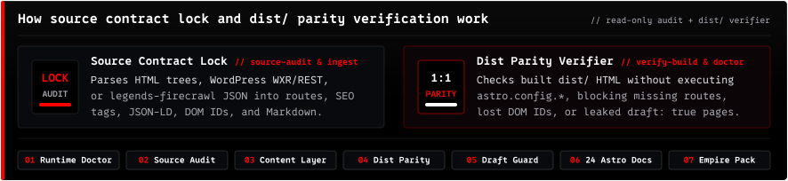
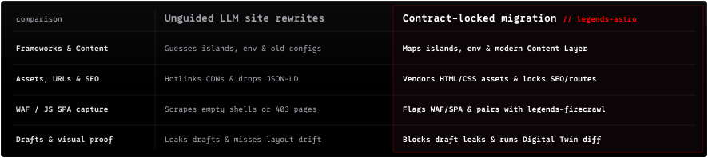

# 

[](https://github.com/avalonreset/legends-astro/releases/latest)
[](https://github.com/avalonreset/legends-astro/actions/workflows/checks.yml)
[](pyproject.toml)
[](package.json)
[](vendor/astro-docs/manifest.json)
[](LICENSE)

**Astro v7 static site migration, WordPress and HTML source contract extraction, Content Layer collection scaffolding, offline official documentation search, and post-build `dist/` SEO parity verification for coding agents.**


```text
Install or update legends-astro via cto-legends (https://github.com/avalonreset/cto-legends): run `cto-legends install legends-astro --apply`, then `cto-legends handoff legends-astro` and follow the returned JSON recipe to verify `legends-astro`.
```


## Why `legends-astro` exists

Prompting an unguided coding agent to "convert our WordPress, Next.js, or HTML site to Astro" routinely breaks search equity and client interactivity in predictable ways:

1. **Outdated Astro v4/v5 Content Collections syntax:** Frontier models default to stale training patterns (`src/content/config.ts`, `type: 'content'`, and `entry.slug`) that fail in Astro v7 Content Layer builds (`src/content.config.ts`, `glob()` from `astro/loaders`, `z` from `astro/zod`, and `entry.id`).
2. **Silent route-shape drift and dropped SEO metadata:** Casual component rewrites alter trailing slashes (`/page.html` vs `/page/index.html`), drop `<link rel="canonical">` or JSON-LD `@type` schema blocks, and delete DOM `id` attributes referenced by client-side JavaScript (`getElementById`, `querySelector`).
3. **Production draft leaks and reordered first-paint styles:** Static path builders omit `draft !== true` filters so unpublished articles ship to production, while inline critical `<style data-first-paint>` blocks get moved below blocking scripts in `<head>`.

`legends-astro` gives your coding agent a **contract-locked migration and post-build parity workflow**. Before writing a component, `source-audit` extracts a deterministic `migration-contract.json` from your legacy HTML tree, WordPress WXR `.xml` or REST `.json` export, or [`legends-firecrawl`](https://github.com/avalonreset/legends-firecrawl) capture. After `astro build`, `verify-build` audits the compiled `dist/` directory against that contract and blocks release if any route, meta tag, JSON-LD block, or JavaScript DOM selector went missing.

## Ask in plain english

Once [`cto-legends`](https://github.com/avalonreset/cto-legends) is installed, you ask your coding agent in plain english. It inspects your Node and Astro runtime, locks the source migration contract first, previews Content Layer scaffolding before touching disk, and verifies `dist/` after building:


## Architecture: source contract lock and `dist/` parity verifier



### 1. Pre-migration source contract lock and Content Layer scaffolding (`source-audit` & `ingest`)

When migrating from legacy HTML directories, WordPress WXR `.xml` exports, WordPress REST `.json` dumps, or [`legends-firecrawl`](https://github.com/avalonreset/legends-firecrawl) `.json` captures, `legends-astro` separates read-only discovery from guarded project scaffolding:

- **Deterministic pre-migration contract (`migration-contract.json`):** `source-audit` records every published route and URL shape (`file`, `directory`, `clean`, `root`), recommended `build.format` and `trailingSlash` settings, `<title>`, `<meta name="description">`, canonical link, OpenGraph, Twitter Card, JSON-LD `@type` blocks, and every DOM `id` cross-referenced against `.js` selector queries.
- **Preview-first Astro v7 Content Layer generation (`ingest`):** Running `ingest` defaults to a read-only preview that computes `plannedFiles` and a `planSha256` digest. Passing `--apply --confirm-plan <planSha256>` writes `src/content.config.ts` (`glob()` + `astro/zod`), `src/lib/published.ts` (`draft !== true` filter), converted Markdown pages (`src/content/pages/*.md`), and legacy route aliases in `public/_redirects` with CWE-59 symlink refusal and CWE-776 XML entity rejection.

### 2. The `legends-astro` CLI surface

Every subcommand runs locally with zero mandatory Python third-party dependencies and never imports or executes untrusted consumer `astro.config.*` files during inspection:

| Surface | `legends-astro` Subcommand | What It Does |
| :--- | :--- | :--- |
| **Runtime & Config Readiness** | `doctor` | Checks Node runtime (`>=22.12.0` / `>=22.23.4`, LTS `24.15.0` tested), global `astro` PATH collisions with Astronomer Airflow CLI, lockfile consistency (`npm`, `pnpm`, `yarn`, `bun`), vendored docs SHA-256 hashes, and Astro v7 traps (`src/content/config.ts`, `prerender = false`). |
| **Pre-Migration Contract Lock** | `source-audit` | Parses legacy HTML folders/files, WordPress WXR `.xml`, WP REST `.json`, or `legends-firecrawl` `.json` into `migration-contract.json` with route shapes, SEO tags, JSON-LD, client-JS DOM IDs, and converted Markdown. |
| **Content Layer Scaffolding** | `ingest` | Previews (`planSha256`) and scaffolds `src/content.config.ts`, `src/lib/published.ts`, clean Markdown entries, `public/_redirects`, and `migration-contract.json`. |
| **Post-Build Parity Gate** | `verify-build` | Audits built `dist/` HTML against `migration-contract.json` and `src/content/` for 1:1 route survival, zero `draft: true` leaks, preserved `<title>`/description/JSON-LD, required client-JS DOM IDs, first-paint `<head>` CSS order, and valid internal links/assets. |
| **Offline Official Astro Docs** | `docs-lookup` | Searches 24 SHA-256-verified `withastro/docs` MDX guides and 9 `wiki/` runbooks offline, plus verified upstream endpoints (`registry.npmjs.org`, `api.github.com`) when `--live-locations` or `--check-live` is passed. |
| **Vault Pack & Resource Paths** | `knowledge-pack`, `resources` | Verifies the 10-file `knowledge/astro/pack.json` (`legends.knowledge-pack/v1`) for attachment into [`legends-empire`](https://github.com/avalonreset/legends-empire) and resolves packaged resource paths across source checkouts and wheel installs. |

### 3. Pinned offline Astro v7 documentation and Empire knowledge pack

- **24 vendored `withastro/docs` MDX guides + 9 operational runbooks:** Verified by SHA-256 against `vendor/astro-docs/manifest.json` (`withastro/docs` commit `0844aab04ea2f3859132ab97b1e9daa01ade76a1`). Because `https://docs.astro.build/llms.txt` and `/llms-full.txt` return HTTP 404 upstream, `legends-astro docs-lookup` gives your agent instant, deterministic offline search across Content Layer, routing, WordPress/Next.js migration, and upgrade guides.
- **Attachable Empire vault pack (`knowledge/astro/pack.json`):** Ships 9 engineering runbooks (`wiki/`) and `templates/migration-receipt.md` ready to attach into a [`legends-empire`](https://github.com/avalonreset/legends-empire) Markdown knowledge vault.

## Unguided rewrites vs `legends-astro`



## Quick start

```sh
# 1. Check local Node runtime, vendored docs checksums, and target Astro project readiness
legends-astro doctor --project /path/to/astro-site --json

# 2. Extract routes, SEO metadata, JSON-LD, client-JS DOM IDs, and Markdown from legacy source
legends-astro source-audit --source /path/to/wp-export.xml --output migration-contract.json

# 3. Preview Astro v7 Content Layer scaffolding (read-only by default; pass --apply --confirm-plan <sha256> to write)
legends-astro ingest --source /path/to/wp-export.xml --output /path/to/astro-site
legends-astro ingest --source /path/to/wp-export.xml --output /path/to/astro-site --apply --confirm-plan <planSha256>

# 4. After running project-local astro check && astro build, verify dist/ against the contract
legends-astro verify-build --dist /path/to/astro-site/dist --project /path/to/astro-site --contract migration-contract.json

# 5. Search the 24 vendored Astro v7 guides and 9 runbooks offline
legends-astro docs-lookup "astro content collections"
legends-astro docs-lookup "wordpress to astro" --live-locations
```

## Reference

<details>
<summary><strong>Knowledge vault runbooks and <code>legends-empire</code> attachment (<code>knowledge-pack</code>)</strong></summary>

Start at [wiki/index.md](wiki/index.md) or attach the versioned knowledge pack at [knowledge/astro/pack.json](knowledge/astro/pack.json) (`legends.knowledge-pack/v1`):

- [Wiki index](wiki/index.md) and [Inspect setup and runtime](wiki/inspect-setup.md)
- [Pages, components, styles, and scripts](wiki/pages-components-styles-scripts.md)
- [Content collections (`src/content.config.ts`)](wiki/content-collections.md)
- [Migrate HTML, WordPress, and Next.js](wiki/migrate-and-wordpress.md)
- [Performance, headers, and caching](wiki/performance-and-caching.md)
- [Diagnose and upgrade Astro v7](wiki/diagnose-and-upgrade.md) and [Latest docs and ecosystem lookup](wiki/latest-docs-and-ecosystem.md)
- [Source ledger](references/sources.md), [Migration receipt template](templates/migration-receipt.md), and [Empire attachment guide](docs/EMPIRE.md)

```sh
legends-astro knowledge-pack --check --json
legends-astro resources --json
cto-legends run legends-empire -- knowledge attach /path/to/legends-astro/knowledge/astro/pack.json --vault /path/to/vault --operation-id op-astro-001 --generated-at 2026-10-24T00:00:00Z
```

</details>

<details>
<summary><strong>Agent setup (via <code>cto-legends</code>) and standalone installation</strong></summary>

### Agent setup (via `cto-legends`)

Part of [`cto-legends`](https://github.com/avalonreset/cto-legends). The central router skill is vendored at [skills/cto-legends/SKILL.md](skills/cto-legends/SKILL.md); this module is not a separate registered skill and does not require an ambient MCP daemon. `legends-astro` replaces the legacy `legends-astro-kit` identifier while retaining `legends-astro-kit` as a compatibility alias in `cto-legends`.

Run `cto-legends handoff legends-astro` and read the returned installed recipe and task-readiness checks ([docs/AGENT-RECIPE.md](docs/AGENT-RECIPE.md)). If the module is missing, preview setup with `cto-legends install legends-astro`, perform the authorized setup, then repeat the handoff.

```sh
cto-legends handoff legends-astro
cto-legends run legends-astro -- doctor --json
```

Direct installation from source (Python 3.11+ and Node.js 22.12.0+, LTS 24.15.0 tested):

```sh
git clone https://github.com/avalonreset/legends-astro.git
cd legends-astro
python -m pip install .
legends-astro doctor --json
```

</details>

<details>
<summary><strong>Repository layout, verification, and scope limits</strong></summary>

```text
Agent / CLI (`legends-astro`)
  -> Static runtime & trap inspection (`doctor`, `scripts/doctor.mjs`, zero config execution)
  -> Pre-migration contract extraction (`source-audit` -> `migration-contract.json`)
  -> Preview-first Content Layer scaffolding (`ingest` -> `src/content.config.ts` + `_redirects`)
  -> Post-build 1:1 parity gate (`verify-build` against `dist/` and `migration-contract.json`)
```

- `legends_astro/`: Python CLI (`cli.py`), source auditor and parity verifier (`auditor.py`), and offline documentation indexer (`docs_nav.py`).
- `scripts/`: Node readiness inspector (`doctor.mjs`), vendored docs SHA-256 verifier (`verify-sources.mjs`), SVG card renderer (`render_cards.py`), and release gates (`check_release.py`).
- `vendor/astro-docs/` & `knowledge/astro/`: 24 SHA-256-pinned `withastro/docs` MDX guides and attachable `legends.knowledge-pack/v1` runbooks.

```sh
python -m unittest discover -s tests -v
node ./scripts/verify-sources.mjs
node ./scripts/test-doctor.mjs
python scripts/check_release.py
```

This module does not deploy sites to hosting providers, run a live browser crawler, or execute untrusted consumer `astro.config.*` files. Pair with [`legends-firecrawl`](https://github.com/avalonreset/legends-firecrawl) for live site scraping and [`legends-cloudflare`](https://github.com/avalonreset/legends-cloudflare), [`legends-coolify`](https://github.com/avalonreset/legends-coolify), or [`legends-hetzner`](https://github.com/avalonreset/legends-hetzner) for infrastructure and DNS cutover. This is an independent community project built around official Astro documentation and CLI workflows and is not affiliated with or endorsed by the Astro project.

</details>

## Contributing, security, and license

See [compatibility and verification](docs/RELEASE-READINESS.md), [contributing](CONTRIBUTING.md), [code of conduct](CODE_OF_CONDUCT.md), [security](SECURITY.md), [support](SUPPORT.md), and [attribution](THIRD_PARTY_NOTICES.md).

MIT License. See [LICENSE](LICENSE) and [THIRD_PARTY_NOTICES.md](THIRD_PARTY_NOTICES.md). Vendored `withastro/docs` files in `vendor/astro-docs/` are MIT licensed (Copyright (c) 2021 Fred K. Schott; see `vendor/astro-docs/LICENSE`).

[](https://github.com/avalonreset/cto-legends/issues/new?title=Message%20for%20Avalon%20Reset&labels=message)

<p align="center"><a href="https://github.com/stars/avalonreset/lists/cto-legends"></a></p>

**Specification & benchmarks on cto-legends.com:**
- **Module specification & architecture matrix:** [cto-legends.com/modules/legends-astro](https://cto-legends.com/modules/legends-astro)
- **Related engineering dispatches:** [How to Build AI Agents: Production CLI & MCP Routing](https://cto-legends.com/blog?post=how-to-build-ai-agents-cli-mcp-routing) · [Fractional CTO Advisory: Technical Due Diligence Guide](https://cto-legends.com/blog?post=fractional-cto-technical-due-diligence-guide)
- **Ecosystem hub:** [cto-legends.com/home](https://cto-legends.com/home)
