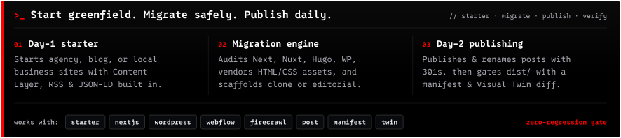
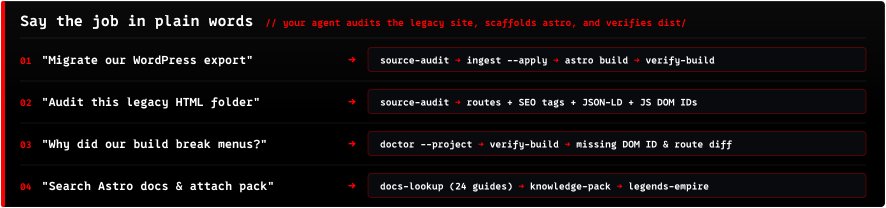

# 

[](https://github.com/avalonreset/legends-astro/releases/latest)
[](https://github.com/avalonreset/legends-astro/actions/workflows/checks.yml)
[](pyproject.toml)
[](package.json)
[](vendor/astro-docs/manifest.json)
[](LICENSE)

**Complete agency Astro lifecycle for coding agents: Day-1 greenfield starter, end-to-end multi-framework, WordPress, Webflow, and HTML to Astro migration engine, two-pass asset localizer, preview-first project scaffolder, Day-2 article-to-live publishing and safe updating, regression manifest gate, Playwright Visual Digital Twin diffing, optional `legends-firecrawl` WAF/SPA pairing, offline official documentation search, and post-build `dist/` parity verification.**


```text
Install or update legends-astro via cto-legends (https://github.com/avalonreset/cto-legends): run `cto-legends install legends-astro --apply`, then `cto-legends handoff legends-astro` and follow the returned JSON recipe to verify `legends-astro`.
```



## Why `legends-astro` exists

Prompting an unguided coding agent to "migrate our Next.js, Nuxt, Gatsby, Hugo, Jekyll, WordPress, Webflow, or HTML site to Astro" routinely breaks search equity, visual styling, and client interactivity in predictable ways:

1. **Outdated Astro Content Collections syntax and blind component hydration:** Frontier models default to stale content config paths (`src/content/config.ts`, `type: 'content'`, and `entry.slug`), guess which components need `client:*` hydration versus zero-JS `.astro`, miss `NEXT_PUBLIC_*` / `VITE_*` / `NUXT_PUBLIC_*` to `PUBLIC_*` env var renames, and overlook framework-specific traps (`next/image`, `gatsby-plugin-image`, Hugo shortcodes, Jekyll Liquid).
2. **Broken remote CDN assets, SRI hashes, WAF blocks, and empty SPA shells:** Naive scrapers silently ingest Cloudflare challenge pages or empty `<div id="root"></div>` shells, keep hotlinking origin CDNs, leave stale `integrity="..."` attributes on localized scripts/stylesheets, miss CSS `@import` and `url(...)` fonts, or ship `/cdn-cgi/l/email-protection` links and live analytics trackers onto staging.
3. **Silent route-shape drift, draft leaks, and visual regressions:** Casual rewrites drop redirects (`vercel.json`, `netlify.toml`, `next.config.*`, `_redirects`), alter trailing slashes (`/page.html` vs `/page/index.html`), drop `<link rel="canonical">` or JSON-LD `@type` blocks, omit `draft !== true` filters in `getStaticPaths()`, delete client-JS DOM `id` attributes, or introduce horizontal overflow and missing fonts.
4. **Unsafe Day-2 edits after launch:** Publishing by hand renames slugs without `301` redirects, resets original `pubDate` on updates, leaks drafts or future-dated posts, uploads unvalidated images, or deletes routes and canonicals with no baseline diff to catch the loss before deploy.

`legends-astro` gives your coding agent a **contract-locked agency lifecycle: Day-1 starter, migration, asset localization, Day-2 publishing, regression gating, and Visual Digital Twin proof**. Start greenfield client sites with `init` or `scaffold --mode starter`; audit source repositories across Next.js, Nuxt, Gatsby, Vite/CRA, Docusaurus, Hugo, Jekyll, Eleventy, and SvelteKit with `source-audit`; capture live sites (with automatic WAF/JS-SPA fallback recommendations to optional [`legends-firecrawl`](https://github.com/avalonreset/legends-firecrawl)) with `capture`; localize HTML + CSS assets with `vendor-assets`; scaffold clone, editorial, or starter Astro projects preview-first with `scaffold`; publish, update, and safely rename articles with `post`; verify `dist/` mechanically and gate Day-2 regressions with `verify-build --baseline`; and prove rendered parity with `twin` and `twin-diff`.

## Ask in plain english

Once [`cto-legends`](https://github.com/avalonreset/cto-legends) is installed, you ask your coding agent in plain english. It inspects your Node and Astro runtime, audits your framework repo or captures the live site, localizes CDN assets, previews scaffolding before touching disk, verifies `dist/` after building, and diffs visual twins:



## Architecture: Day-1 starter, migration, Day-2 publishing, and regression gates


### 1. Complete agency lifecycle (Day-1 starter, migration, Day-2 publishing, regression gate)

- **Multi-framework source repo audit (`source-audit`):** Point `source-audit --source <repo-dir>` at a real codebase to auto-detect Next.js (App Router, Pages Router, or hybrid), Nuxt, Gatsby, Vite / Create React App (React, Vue, Svelte, Preact, Solid), Docusaurus, Hugo, Jekyll, Eleventy, or SvelteKit without ever executing untrusted repo configs. Emits `frameworkMigration` inside `migration-contract.json` covering discovered static/dynamic/API routes, static redirects (`vercel.json`, `netlify.toml`, `_redirects`, `next.config.*`, `nuxt.config.*`), interactive islands (`'use client'`, hooks, reactivity, browser globals) vs zero-JS `.astro` candidates, `PUBLIC_*` env var renames, framework import/syntax traps, Markdown/MDX content collections, and exact vendored `docs-lookup` IDs.
- **Live capture, Migration Triage, and optional `legends-firecrawl` fallback (`capture`):** Captures live origins via recursive XML sitemaps and/or bounded BFS link crawling (with CWE-918 SSRF & DNS-rebinding IP pinning, explicit `--allow-host`, and `https://` default) or normalizes local [`legends-firecrawl`](https://github.com/avalonreset/legends-firecrawl) archives/directories, WordPress WXR `.xml` / REST `.json` exports, and static HTML trees into `raw-capture/`, `migration-contract.json`, and a Migration Triage Report. Automatically flags WAF/bot challenges (HTTP `403`/`429`/`503`, `cf-mitigated`, Cloudflare/Turnstile/Akamai/PerimeterX/DataDome) and empty JS SPA shells (`#root`, `#__next`, `#app`, `#__nuxt`) in `firecrawlFallback` with ready-to-run `legends-firecrawl` handoff commands.
- **Two-pass asset localization (`vendor-assets`):** Extracts HTML `src`, `href`, `srcset`, `data-poster-url`, `data-video-urls`, inline `background-image: url(...)`, and `dynamic_css.php` stylesheets in Pass 1, then recursively crawls CSS `@import` and `url(...)` fonts and backgrounds in Pass 2 into `public/` + `asset-map.json`, with longest-URL-first rewriting and local SRI `integrity=`/`crossorigin=` cleanup.
- **Preview-first project scaffolding (`init`, `scaffold --mode clone|editorial|starter`, `ingest`):** Defaults to a read-only preview computing `plannedFiles` and `planSha256`, requiring `--apply --confirm-plan <planSha256>` to write. Supports Day-1 greenfield `--mode starter` via `init` (`--preset agency|blog|local-business`, `--trailing-slash`, `--site`, `--with-sitemap`/`--no-sitemap`, Content Layer collections, draft plus scheduled `pubDate` filtering, zero-dependency RSS endpoint, `Organization`/`LocalBusiness` plus `BlogPosting` plus `BreadcrumbList` JSON-LD, and repo-local build guidelines), exact-DOM `--mode clone` (`LegacyDocument.astro` with `<Fragment set:html={...} />`, `--decode-cf-email`, `--strip-trackers`, and Triple-Lock `--staging-lock`), and clean Markdown `--mode editorial` (preserving Custom Post Types, taxonomies, authors, `_thumbnail_id` featured images, and Yoast/RankMath SEO titles).
- **Day-2 publishing, updating, and regression gate (`post` -> `astro build` -> `verify-build --baseline`):** Takes raw Markdown to a live page with read-only `--list`, preview-first create (`--input`, `--hero`, `--hero-alt`), `--update` preserving `pubDate` and stamping `updatedDate`, safe `--rename-from` appending deduplicated `301` rules to `public/_redirects`, magic-byte and SVG safety checks, and editorial SEO lint. Non-technical writers can use zero-lock-in Git-backed CMS editors writing Markdown into `src/content/blog/` while the same `verify-build --write-manifest` / `--baseline` manifest gate blocks lost routes, canonicals, titles, descriptions, H1s, or JSON-LD types in CI.

### 2. The `legends-astro` CLI surface

Every subcommand runs locally with zero mandatory Python or Node dependencies (Playwright and `legends-firecrawl` are strictly optional runtime companions) and never imports or executes untrusted consumer configs during inspection:

| Surface | `legends-astro` Subcommand | What It Does |
| :--- | :--- | :--- |
| **Runtime & Ecosystem Doctor** | `doctor` | Checks Node runtime, global `astro` PATH collisions with Astronomer Airflow CLI, lockfile consistency (`npm`, `pnpm`, `yarn`, `bun`), vendored docs SHA-256 hashes, Astro Content Layer traps (`src/content/config.ts`, `prerender = false`), non-blocking optional `ecosystem` detection (`legends-firecrawl`, Playwright), and optional `--live` registry/docs freshness. |
| **Multi-Framework & Source Audit** | `source-audit` | Read-only static auditor for Next.js, Nuxt, Gatsby, Vite/CRA, Docusaurus, Hugo, Jekyll, Eleventy, and SvelteKit repos, plus HTML trees, `raw-capture/`, WordPress WXR `.xml` / REST `.json`, and `legends-firecrawl` directories into `migration-contract.json`. |
| **Live & Firecrawl Capture** | `capture` | Captures live HTML via recursive XML sitemaps and bounded BFS crawling or normalizes local `legends-firecrawl` archives/directories into `raw-capture/`, `migration-contract.json`, a Migration Triage Report, and automatic WAF/SPA `firecrawlFallback` diagnostics. |
| **Two-Pass Asset Localizer** | `vendor-assets` | Downloads allowlisted origin, WordPress, and Webflow CDN assets from HTML (Pass 1) and recursive CSS `@import`/`url(...)` (Pass 2) into `public/` + `asset-map.json` with `--dry-run` preview and SRI stripping. |
| **Project & Content Scaffolder** | `init`, `scaffold`, `ingest` | Previews (`planSha256`) and generates buildable Astro projects in `--mode clone` (exact DOM fidelity, CF email decoding, tracker stripping, Triple-Lock staging), `--mode editorial` (clean Markdown CMS), or Day-1 `--mode starter` via `init` (agency, blog, or local-business preset), or Content Layer-only `ingest`. |
| **Day-2 Publisher & Updater** | `post` | Read-only `--list`, preview-first article create with hero and inline image localization, `--update` preserving `pubDate`, safe `--rename-from` with `301` updates to `public/_redirects`, and editorial SEO preflight lint. |
| **Post-Build Parity Gate** | `verify-build` | Audits built `dist/` HTML and CSS against `migration-contract.json`, `src/content/`, and an optional `--baseline` site manifest for route parity, zero draft and scheduled future-`pubDate` leaks (`scheduledEntriesChecked`, `scheduled_post_route_leaked`, `scheduled_post_body_leaked`, `scheduled_post_in_sitemap`), `rss.xml` XML/XXE verification (`rss_invalid_xml`), SEO/canonical/OG/JSON-LD/H1/Webflow `data-wf-page` parity, client-JS DOM IDs, first-paint CSS order, CSS assets, SRI checks, `--forbid-host`, `--env staging\|production`, XXE-safe sitemaps, `_redirects`, and `/cdn-cgi/` or `[shortcode]` leaks. Writes a fail-closed manifest with `--write-manifest`. |
| **Visual Digital Twin & Diff** | `twin`, `twin-diff` | Captures desktop (`1440x900`) and mobile (`390x844`) screenshots plus computed-style inventories from live `--url` or local `--dist` (ephemeral in-process loopback server), then compares baseline vs candidate offline via `twin-diff`. |
| **Offline Official Astro Docs** | `docs-lookup` | Searches SHA-256-verified `withastro/docs` MDX guides (including every official framework migration guide) and operational `wiki/` runbooks offline, plus verified upstream endpoints (`registry.npmjs.org`, `api.github.com`) when `--live-locations` or `--check-live` is passed. |
| **Vault Pack & Resource Paths** | `knowledge-pack`, `resources` | Verifies `knowledge/astro/pack.json` (`legends.knowledge-pack/v1`) for attachment into [`legends-empire`](https://github.com/avalonreset/legends-empire) and resolves packaged resource paths across source checkouts and wheel installs. |

### 3. Pinned offline Astro documentation and Empire knowledge pack

- **SHA-256-verified `withastro/docs` MDX guides + operational runbooks:** Verified offline against `vendor/astro-docs/manifest.json`, covering the complete official `migrate-to-astro/` library (WordPress, Next.js, Nuxt, Gatsby, Create React App, Docusaurus, Hugo, Jekyll, Eleventy, SvelteKit, VuePress, GitBook, Gridsome, Pelican) alongside Content Layer, Fonts API, `astro:assets`, `@astrojs/sitemap`, Cloudflare/Node adapters, Vite plugin, routing, and upgrade guides. Because `https://docs.astro.build/llms.txt` and `/llms-full.txt` return HTTP 404 upstream, `legends-astro docs-lookup` gives your agent instant, deterministic offline search.
- **Attachable Empire vault pack (`knowledge/astro/pack.json`):** Ships engineering runbooks (`wiki/`) and `templates/migration-receipt.md` ready to attach into a [`legends-empire`](https://github.com/avalonreset/legends-empire) Markdown knowledge vault.

## Unguided rewrites vs `legends-astro`


## Quick start

```sh
# Day-1 greenfield: preview a starter, then apply with planSha256 confirmation
legends-astro init --output /path/to/client-site --preset agency --site https://example.com
legends-astro init --output /path/to/client-site --preset agency --site https://example.com --apply --confirm-plan <planSha256>

# Day-2 publishing: list, preview a create, apply, build, and regression-gate
legends-astro post --project /path/to/client-site --list
legends-astro post --project /path/to/client-site --input /path/to/article.md --hero /path/to/cover.png --hero-alt "Describe the cover image" --publish
legends-astro post --project /path/to/client-site --input /path/to/article.md --hero /path/to/cover.png --hero-alt "Describe the cover image" --publish --apply --confirm-plan <planSha256>
legends-astro verify-build --dist /path/to/client-site/dist --project /path/to/client-site --baseline /path/to/client-site/site-manifest.json --write-manifest /path/to/client-site/site-manifest.json --overwrite --env production

# Migration path:
# 1. Check local Node runtime, vendored docs checksums, optional ecosystem tools, and Astro project readiness
legends-astro doctor --project /path/to/astro-site --json

# 2a. Audit an existing framework repo (Next.js, Nuxt, Gatsby, Vite/CRA, Docusaurus, Hugo, Jekyll, Eleventy, SvelteKit)
legends-astro source-audit --source /path/to/legacy-repo --output /path/to/migration-contract.json

# 2b. Or capture a live site (or normalize a legends-firecrawl dir) with Migration Triage and WAF/SPA fallback detection
legends-astro capture --url https://example.com --from-sitemap --crawl --output /path/to/work

# 3. Localize remote origin/CDN HTML + CSS assets (Pass 1 + Pass 2)
legends-astro vendor-assets --source /path/to/work/raw-capture --output /path/to/astro-site --allow-host example.com --allow-host cdn.prod.website-files.com

# 4. Preview Astro scaffolding, then apply with planSha256 confirmation
legends-astro scaffold --source /path/to/work/raw-capture --output /path/to/astro-site --mode clone --asset-map /path/to/astro-site/asset-map.json --decode-cf-email --strip-trackers --staging-lock
legends-astro scaffold --source /path/to/work/raw-capture --output /path/to/astro-site --mode clone --asset-map /path/to/astro-site/asset-map.json --decode-cf-email --strip-trackers --staging-lock --apply --confirm-plan <planSha256>

# 5. After running project-local astro build, verify dist/ against the contract and staging lock
legends-astro verify-build --dist /path/to/astro-site/dist --project /path/to/astro-site --contract /path/to/work/migration-contract.json --forbid-host cdn.prod.website-files.com --env staging

# 6. Capture Visual Digital Twins and run offline parity diff (Playwright optional)
legends-astro twin --dist /path/to/astro-site/dist --output /path/to/twin-candidate
legends-astro twin-diff --baseline /path/to/twin-baseline/twin.json --candidate /path/to/twin-candidate/twin.json

# 7. Search vendored official Astro migration guides and runbooks offline
legends-astro docs-lookup "nextjs"
legends-astro docs-lookup "hugo" --live-locations
```

## Reference

<details>
<summary><strong>Knowledge vault runbooks and <code>legends-empire</code> attachment (<code>knowledge-pack</code>)</strong></summary>

Start at [wiki/index.md](wiki/index.md) or attach the versioned knowledge pack at [knowledge/astro/pack.json](knowledge/astro/pack.json) (`legends.knowledge-pack/v1`):

- [Wiki index](wiki/index.md) and [Inspect setup and runtime](wiki/inspect-setup.md)
- [Agency starter guidelines](wiki/agency-starter-guidelines.md) and [Publishing and content ops](wiki/publishing-and-content-ops.md)
- [Pages, components, styles, and scripts](wiki/pages-components-styles-scripts.md)
- [Content collections (`src/content.config.ts`)](wiki/content-collections.md)
- [Migrate frameworks, WordPress, Webflow, HTML, and Firecrawl](wiki/migrate-and-wordpress.md)
- [Performance, headers, and caching](wiki/performance-and-caching.md)
- [Diagnose and upgrade Astro](wiki/diagnose-and-upgrade.md) and [Latest docs and ecosystem lookup](wiki/latest-docs-and-ecosystem.md)
- [Source ledger](references/sources.md), [Migration receipt template](templates/migration-receipt.md), and [Empire attachment guide](docs/EMPIRE.md)

```sh
legends-astro knowledge-pack --check --json
legends-astro resources --json
cto-legends run legends-empire -- knowledge attach /path/to/legends-astro/knowledge/astro/pack.json --vault /path/to/vault --operation-id op-astro-001 --generated-at 2026-11-24T00:00:00Z
```

</details>

<details>
<summary><strong>Agent setup (via <code>cto-legends</code>) and standalone installation</strong></summary>

### Agent setup (via `cto-legends`)

Part of [`cto-legends`](https://github.com/avalonreset/cto-legends). The central router skill is vendored at [skills/cto-legends/SKILL.md](skills/cto-legends/SKILL.md); this module is not a separate registered skill and does not require an ambient MCP daemon. `legends-astro` replaces the legacy `legends-astro-kit` identifier while retaining `legends-astro-kit` as a compatibility alias in `cto-legends`.

Run `cto-legends handoff legends-astro` and read the returned installed recipe and task-readiness checks ([docs/AGENT-RECIPE.md](docs/AGENT-RECIPE.md)). If the module is missing, preview setup with `cto-legends install legends-astro`, perform the authorized setup, then repeat the handoff.

```sh
cto-legends handoff legends-astro
cto-legends run legends-astro -- doctor --json
```

Direct installation from source:

```sh
git clone https://github.com/avalonreset/legends-astro.git
cd legends-astro
python -m pip install .
legends-astro doctor --json
```

</details>

<details>
<summary><strong>Repository layout, verification, and scope limits</strong></summary>

```text
Agent / CLI (`legends-astro`)
  -> Static runtime, trap & ecosystem inspection (`doctor`, `scripts/doctor.mjs`, zero config execution)
  -> Multi-framework repo audit (`source-audit`, `framework_audit.py` -> routes, islands, redirects, env, traps)
  -> Live / Firecrawl capture, Triage & WAF/SPA fallback (`capture` -> `raw-capture/` + `migration-contract.json`)
  -> Two-pass HTML + CSS asset localization (`vendor-assets` -> `public/` + `asset-map.json`)
  -> Preview-first Astro scaffolding (`init`, `scaffold --mode clone|editorial|starter`, `ingest`)
  -> Day-2 article publishing and safe updating (`post` -> `public/_redirects`)
  -> Post-build parity and regression gate (`verify-build` against `dist/`, `migration-contract.json`, `--baseline`)
  -> Visual Digital Twin & offline parity diff (`twin`, `twin-diff`, `scripts/twin.mjs`)
```

- `legends_astro/`: Python CLI (`cli.py`), shared network/filesystem safety (`net_safety.py`), multi-framework static repo auditor (`framework_audit.py`), live/Firecrawl capture & WAF/SPA triage (`capture.py`), two-pass asset vendorer (`vendor.py`), preview-first scaffolder (`scaffold.py`), Day-2 publisher & editorial linter (`publisher.py`), visual twin runner/diff (`twin.py`), source auditor & build parity verifier (`auditor.py`), and offline documentation indexer (`docs_nav.py`).
- `scripts/`: Node readiness inspector (`doctor.mjs`), Playwright Digital Twin worker (`twin.mjs`), vendored docs SHA-256 verifier (`verify-sources.mjs`), SVG card renderer (`render_cards.py`), and release gates (`check_release.py`).
- `vendor/astro-docs/` & `knowledge/astro/`: SHA-256-pinned `withastro/docs` MDX guides and attachable `legends.knowledge-pack/v1` runbooks.

```sh
python -m unittest discover -s tests -v
node ./scripts/verify-sources.mjs
node ./scripts/test-doctor.mjs
python scripts/check_release.py
```

This module does not deploy sites to hosting providers, spawn detached background dev servers, or execute untrusted consumer configs. Pair with optional [`legends-firecrawl`](https://github.com/avalonreset/legends-firecrawl) for WAF-protected or heavy JS-rendered SPA scraping and [`legends-cloudflare`](https://github.com/avalonreset/legends-cloudflare), [`legends-coolify`](https://github.com/avalonreset/legends-coolify), or [`legends-hetzner`](https://github.com/avalonreset/legends-hetzner) for infrastructure and DNS cutover. This is an independent community project built around official Astro documentation and CLI workflows and is not affiliated with or endorsed by the Astro project.

</details>

## Contributing, security, and license

See [compatibility and verification](docs/RELEASE-READINESS.md), [contributing](CONTRIBUTING.md), [code of conduct](CODE_OF_CONDUCT.md), [security](SECURITY.md), [support](SUPPORT.md), and [attribution](THIRD_PARTY_NOTICES.md).

MIT License. See [LICENSE](LICENSE) and [THIRD_PARTY_NOTICES.md](THIRD_PARTY_NOTICES.md). Vendored `withastro/docs` files in `vendor/astro-docs/` are MIT licensed (Copyright (c) 2021 Fred K. Schott; see `vendor/astro-docs/LICENSE`).

## Start here

Paste the [agent handoff block](#top) at the top of this page into your coding agent, let it wire the `cto-legends` router skill, and speak your task in plain English.

Running a company and not a terminal? Founders and operators who want this way of working applied directly to their own business stack have one route: message Avalon Reset at [cto-legends.com/dm](https://cto-legends.com/dm) or start with a 48-hour diagnostic at [cto-legends.com/home#home-offer](https://cto-legends.com/home#home-offer). The desk is async, so the conversation starts the moment you write and nobody forces you onto a sales call.

<p align="center"><a href="https://cto-legends.com/dm"></a></p>

<p align="center"><a href="https://github.com/stars/avalonreset/lists/cto-legends"></a></p>

**Specification & benchmarks on cto-legends.com:**
- **Module specification & architecture matrix:** [cto-legends.com/modules/legends-astro](https://cto-legends.com/modules/legends-astro)
- **Related engineering dispatches:** [How to Choose MCP vs CLI Tools Without Context Bloat](https://cto-legends.com/blog?post=mcp-vs-cli) · [How to Vet an AI Implementation Consultant in 15 Minutes](https://cto-legends.com/blog?post=ai-implementation-consultant)
- **Ecosystem hub:** [cto-legends.com/home](https://cto-legends.com/home)
