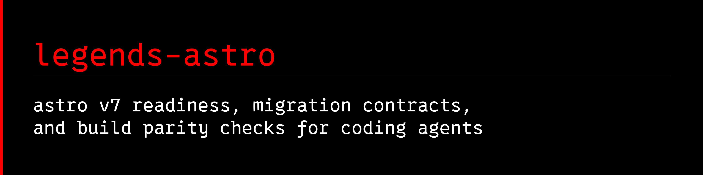

<a name="banner"></a>
<a name="legends-astro"></a>

# 

[](https://github.com/avalonreset/legends-astro/releases/latest)
[](https://github.com/avalonreset/legends-astro/actions/workflows/checks.yml)
[](LICENSE)

`legends-astro` is the Astro v7 site migration, readiness, build parity verification, and curated documentation module for the `cto-legends` ecosystem. It replaces the legacy `legends-astro-kit` name while retaining `legends-astro-kit` as a compatibility alias.

## Why `legends-astro` exists

Prompting a generic frontier LLM to "convert my WordPress or HTML site to Astro" routinely breaks in six predictable ways:

1. **Outdated Astro v4/v5 Content Collections syntax:** Models write `src/content/config.ts`, `type: 'content'`, and `entry.slug` instead of Astro v7 Content Layer `src/content.config.ts`, `glob()` from `astro/loaders`, `z` from `astro/zod`, and `entry.id`.
2. **Broken client-side JavaScript & DOM IDs:** Models rename or drop DOM element `id` attributes referenced by `document.getElementById(...)` or `querySelector('#...')`.
3. **First-paint CSS extraction flash:** Models omit `is:inline` on critical `<head>` `<style>` blocks, causing Astro to bundle them after scripts.
4. **Silent SEO & route shape regressions:** Models change `/page.html` to `/page/index.html` without matching `build.format` and `trailingSlash`, or drop canonical tags, OpenGraph metadata, and JSON-LD blocks.
5. **Accidental draft publication:** Models forget that Astro `getCollection()` includes `draft: true` entries by default in production unless filtered in both index listings and `getStaticPaths()`.
6. **Global `astro` binary collision:** On Windows (`winget`), global `astro` resolves to the Astronomer Airflow CLI, and official Astro forbids global installs.

`legends-astro` pairs an offline-verified Astro v7 documentation snapshot (24 official MDX guides from `withastro/docs` commit `0844aab04ea2f3859132ab97b1e9daa01ade76a1`) with deterministic pre-migration contract extraction (`source-audit`), Content Layer scaffolding (`ingest`), and post-build parity verification (`verify-build`).

## Install

Through `cto-legends`:

```sh
cto-legends install legends-astro
cto-legends install legends-astro --apply
cto-legends handoff legends-astro
```

Direct from source:

```sh
git clone https://github.com/avalonreset/legends-astro.git
cd legends-astro
python -m pip install .
```

## CLI reference

### 1. Inspect runtime and Astro project readiness (`doctor`)

```sh
legends-astro doctor --json
legends-astro doctor --project /path/to/astro-site --json
legends-astro doctor --project /path/to/astro-site --strict-pin --json
legends-astro doctor --live --json
```

Inspects Node runtime (`>=22.12.0` for `astro@7.3.1`, `>=22.23.4` for `astro@7.4.2`, tested LTS baseline `24.15.0`), checks for global `astro` PATH collisions, verifies the 27-file `vendor/astro-docs/manifest.json` SHA-256 snapshot and `knowledge/astro/pack.json`, validates local `node_modules/astro/bin/astro.mjs` and lockfile consistency (`npm`, `pnpm`, `yarn`, `bun`), and flags Astro v7 traps (`src/content/config.ts` vs `src/content.config.ts`, `prerender = false` routes). Never imports or executes consumer `astro.config.*` files.

### 2. Extract a pre-migration contract (`source-audit`)

```sh
legends-astro source-audit --source /path/to/legacy-html-or-wp.xml --output migration-contract.json
```

Audits a legacy HTML directory/file, WordPress WXR `.xml` export, WordPress REST `.json` dump, or `legends-firecrawl` `.json` scrape and produces a deterministic `migration-contract.json` recording:
- Every route and URL shape (`file`, `directory`, `clean`, `root`) plus recommended `build.format` and `trailingSlash` settings
- `<title>`, `<meta name="description">`, canonical link, OpenGraph, Twitter Card, and JSON-LD `@type` blocks
- Every DOM `id` and `data-*` attribute, cross-referenced against `getElementById` / `querySelector('#...')` in `.js` files
- Inline `<head>` styles, scripts, forms, internal links, local assets, and clean converted Markdown body content

### 3. Scaffold an Astro v7 Content Layer collection (`ingest`)

```sh
# Preview planned files (read-only)
legends-astro ingest --source /path/to/wp-export.xml --output /path/to/astro-site

# Write files when authorized
legends-astro ingest --source /path/to/wp-export.xml --output /path/to/astro-site --apply
```

Generates `src/content.config.ts` (using `glob()` from `astro/loaders` and `z` from `astro/zod`), `src/lib/published.ts` (`draft !== true` filter), `src/content/pages/*.md` with converted Markdown body content, `public/_redirects` for legacy route aliases, and `migration-contract.json`.

### 4. Verify built `dist/` parity (`verify-build`)

```sh
legends-astro verify-build --dist /path/to/astro-site/dist --project /path/to/astro-site --contract migration-contract.json
```

Mechanically verifies that:
- Every published route in `migration-contract.json` exists in `dist/`
- No `draft: true` entry in `src/content/` leaked a route or body text into `dist/`
- No `<title>`, `<meta name="description">`, or JSON-LD block was lost
- Every required client-JS DOM `id` is preserved in the built HTML
- First-paint `<style data-first-paint>` blocks remain inline in `<head>` before any `<script>`
- All internal `<a href="/...">` links and local asset references resolve inside `dist/`

### 5. Search vendored Astro v7 docs and live upstream locations (`docs-lookup`)

```sh
legends-astro docs-lookup "wordpress" --live-locations
legends-astro docs-lookup "content collections"
legends-astro docs-lookup --list
legends-astro docs-lookup --check-live
```

Searches the 24 vendored `withastro/docs` MDX pages and 9 operational runbooks in `wiki/`, and reports verified upstream endpoints (`registry.npmjs.org/astro/latest`, `api.github.com/repos/withastro/docs/commits/main`) when live checks are needed. Note that `https://docs.astro.build/llms.txt` and `/llms-full.txt` return HTTP 404 upstream; always use `legends-astro docs-lookup` or the GitHub raw MDX tree.

## Knowledge vault and `legends-empire` pack

- [Wiki index](wiki/index.md)
- [Inspect setup and runtime](wiki/inspect-setup.md)
- [Pages, components, styles, and scripts](wiki/pages-components-styles-scripts.md)
- [Content collections (`src/content.config.ts`)](wiki/content-collections.md)
- [Migrate HTML, WordPress, and Next.js](wiki/migrate-and-wordpress.md)
- [Performance, headers, and caching](wiki/performance-and-caching.md)
- [Diagnose and upgrade Astro v7](wiki/diagnose-and-upgrade.md)
- [Latest docs and ecosystem lookup](wiki/latest-docs-and-ecosystem.md)
- [Source ledger](references/sources.md)
- [Migration receipt template](templates/migration-receipt.md)
- [Empire attachment guide](docs/EMPIRE.md)

Attach the knowledge pack to an Empire vault via `legends-empire`:

```sh
cto-legends run legends-empire -- knowledge attach /path/to/legends-astro/knowledge/astro/pack.json --vault /path/to/vault --operation-id op-astro-001 --generated-at 2026-10-24T00:00:00Z
```

## Verification

```sh
python -m unittest discover -s tests -v
node ./scripts/verify-sources.mjs
node ./scripts/test-doctor.mjs
python scripts/check_release.py
```

## License

MIT. Vendored `withastro/docs` files in `vendor/astro-docs/` are MIT licensed (Copyright (c) 2021 Fred K. Schott; see `vendor/astro-docs/LICENSE` and `THIRD_PARTY_NOTICES.md`).
